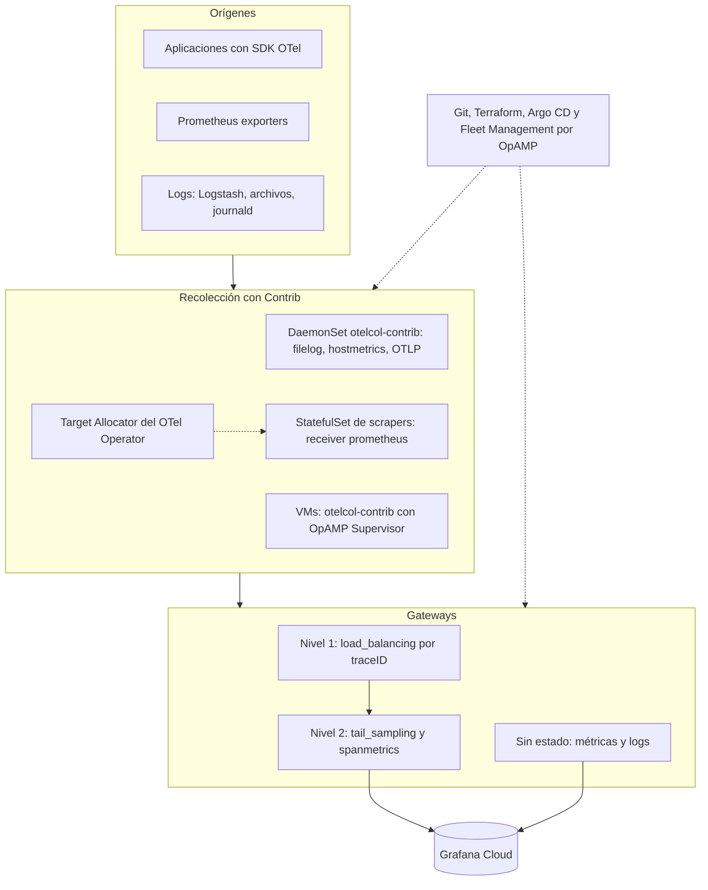

La opción A separa el trabajo en cuatro piezas: agentes por nodo y por VM, scrapers de Prometheus repartidos con Target Allocator, un tier de balanceo por traceID y un tier de muestreo con estado, todo administrado por Git y por Fleet Management con OpAMP.

### Componentes y su estado {{V}}

| Pieza | Componente | Estado |
| --- | --- | --- |
| Scrape de Prometheus | Receiver `prometheus` | {{BETA}} para métricas; rechaza `remote_write`, `remote_read`, `rule_files` y la configuración de alertmanagers |
| Reparto de targets | Target Allocator del OTel Operator | Componente opcional del recurso `OpenTelemetryCollector`; descubre ServiceMonitor y PodMonitor |
| Balanceo | Exportador `load_balancing` (antes `loadbalancing`) | {{BETA}} trazas y logs, {{ALPHA}} métricas |
| Muestreo | Procesador `tail_sampling` | {{BETA}} |
| Administración | OpAMP Supervisor con Fleet Management | OpAMP en beta; sin guía oficial de Fleet Management para Kubernetes con Contrib {{N}} |

### Límites de esta opción

- El Supervisor exige un `supervisor.yaml` por collector y un directorio de storage persistente; en Kubernetes habría que empaquetarlo junto al collector {{I}}.
- El receiver Prometheus es un componente con estado: dos réplicas con la misma configuración scrapean dos veces los mismos targets, salvo que el Target Allocator los reparta.
- Kubernetes Monitoring con receivers OTel soporta CPU, memoria, eventos y logs, y no soporta alertas todavía {{V}}.

Fuentes: <a href="https://github.com/open-telemetry/opentelemetry-collector-contrib/blob/main/receiver/prometheusreceiver/README.md">README del receiver Prometheus</a>, <a href="https://pkg.go.dev/github.com/open-telemetry/opentelemetry-collector-contrib/exporter/loadbalancingexporter">loadbalancingexporter</a>, <a href="https://pkg.go.dev/github.com/open-telemetry/opentelemetry-collector-contrib/processor/tailsamplingprocessor">tailsamplingprocessor</a>, <a href="https://grafana.com/docs/grafana-cloud/observe-and-act/monitor-infrastructure/kubernetes-monitoring/configuration/config-other-methods/otel-collector-receivers.md">Kubernetes con receivers OTel</a>.

