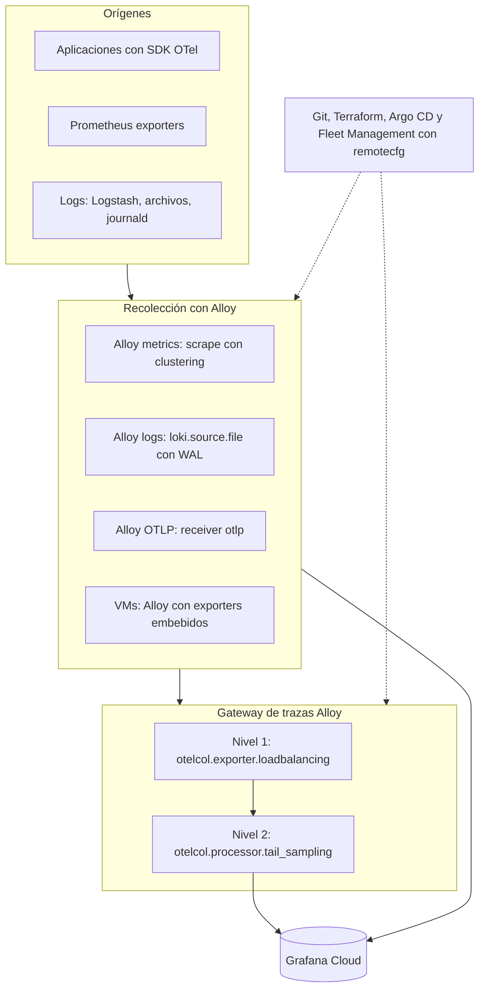

En la opción B el descubrimiento, el reparto de scrape, la recolección de logs y el registro en Fleet Management viven en el mismo binario; las piezas externas se reducen a Helm y Git. El gateway de trazas sigue siendo un tier separado.

### Componentes y su estado {{V}}

| Pieza | Componente de Alloy | Estado |
| --- | --- | --- |
| Descubrimiento | `discovery.kubernetes`, `.ec2`, `.azure`, `.dns`, `.file`, `.http`, `.consul` y otros | Motor por defecto, estable |
| Reparto de scrape | `clustering` en `prometheus.scrape` | Gossip, hashing consistente, activación por componente |
| Logs | `loki.source.file`, `loki.source.kubernetes`, `loki.write` con bloque `wal` | Motor por defecto |
| Trazas | `otelcol.exporter.loadbalancing`, `otelcol.processor.tail_sampling` | `tail_sampling` GA; `loadbalancing` envuelve el exportador upstream |
| Administración | `remotecfg` con Fleet Management; chart v2.0 o posterior | Onboarding oficial en Kubernetes |
| Salida de portabilidad | Motor OTel (`alloy otel`) | {{PV}}; `otel-supervisor` {{EXP}} |

### Límites de esta opción

- La sintaxis del motor por defecto es propia de Alloy; la portabilidad se resuelve en la instrumentación y en el uso de OTLP, no en el archivo de configuración.
- Alloy no incluye `groupbytrace` ni el conector `routing` en el motor por defecto ni en el bundle OTel {{I}} (inferido de la lista de componentes).
- El motor OTel no tiene UI, support bundles ni endpoint de recarga {{V}}.

Fuentes: <a href="https://grafana.com/docs/alloy/latest/introduction/otel_alloy/">OpenTelemetry en Alloy</a>, <a href="https://grafana.com/docs/alloy/latest/configure/clustering/distribute-workload/">distribución de carga con clustering</a>, <a href="https://grafana.com/docs/alloy/latest/reference/components/otelcol/otelcol.processor.tail_sampling/">tail_sampling</a>, <a href="https://grafana.com/docs/grafana-cloud/observe-and-act/send-data/fleet-management/set-up/onboard-collectors/kubernetes.md">Kubernetes</a>.

