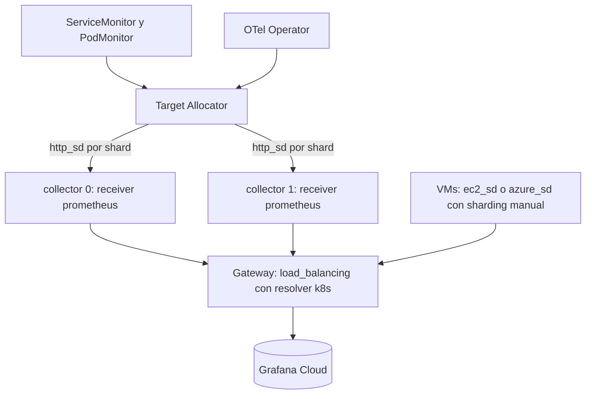

Sí se puede construir una arquitectura funcionalmente equivalente sin Alloy. La contrapartida es operar el OTel Operator, el Target Allocator y un par de resolvers más, y aceptar las limitaciones del receiver Prometheus.

### Qué se agrega frente a Alloy

| Pieza adicional | Para qué | Esfuerzo estimado de implantación y pruebas |
| --- | --- | --- |
| OTel Operator con CRD `OpenTelemetryCollector` | Gestionar collectors y habilitar Target Allocator | 3 a 5 días-persona |
| Target Allocator | Repartir targets entre réplicas y evitar scrape duplicado | 2 a 4 días-persona |
| Prometheus Operator CRDs | Reutilizar ServiceMonitor y PodMonitor existentes | 1 a 2 días-persona si ya existen |
| RBAC y EndpointSlice para el resolver `k8s` | Descubrir gateways | 0,5 a 1 día-persona |
| Sharding manual en VMs | El Target Allocator solo cubre Kubernetes | 2 a 3 días-persona por patrón |
| Empaquetado del Supervisor | Fleet Management con OTel en Kubernetes | 3 a 5 días-persona {{N}} |

Total adicional frente a Alloy: unos **12 a 20 días-persona** en un entorno empresarial multiambiente, estimación del analista sin benchmark.

### Limitaciones que persisten {{V}}

- El receiver Prometheus es un componente con estado y no autoescala el scrape sin Target Allocator.
- Rechaza `alert_config.alertmanagers`, `remote_read`, `remote_write` y `rule_files`: no reemplaza un servidor Prometheus con reglas.
- El Target Allocator es una pieza de Kubernetes: las VMs quedan fuera del reparto automático {{I}}.
- El resolver `k8s` del balanceador excluye endpoints no listos y exige permisos sobre EndpointSlice.

### Qué mecanismo usar para descubrir cada cosa

| Qué descubrir | Alloy | Contrib sin Alloy |
| --- | --- | --- |
| Pods y servicios | `discovery.kubernetes` con `clustering` | Receiver Prometheus con Target Allocator |
| Máquinas virtuales | `discovery.ec2` o `discovery.azure` | `ec2_sd` o `azure_sd` con sharding manual |
| Prometheus exporters | `prometheus.exporter.*` embebidos o `prometheus.scrape` | Receiver Prometheus |
| Endpoints de aplicaciones | `prometheus.operator.*` o anotaciones | Target Allocator con ServiceMonitor |
| Gateways OTel | Resolver `kubernetes` o `dns` | Resolver `k8s` o `dns` |
| Collectors de un clúster distribuido | Clustering de Alloy | Target Allocator (reparto de targets) |
