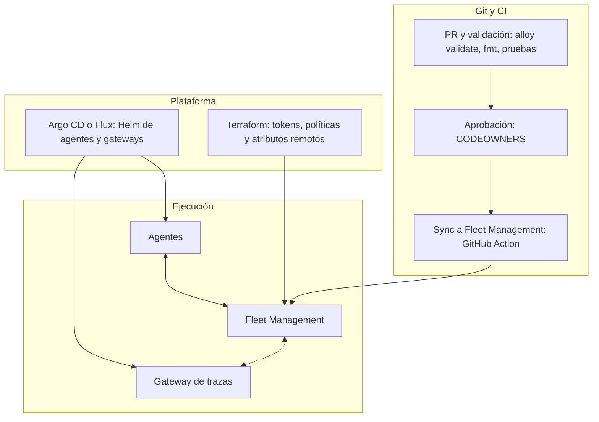

<p class="lead">Para no tener tres fuentes de verdad, Git define la configuración de recolección, Terraform define la plataforma de Grafana Cloud y Argo CD o Flux despliega los agentes; Fleet Management solo distribuye lo que Git le entrega.</p>



### Responsable por tipo de recurso

| Recurso | Sistema responsable | Regla | Evidencia |
| --- | --- | --- | --- |
| Pipelines de recolección | Git con `fleet-management-sync-action` | Nadie los edita en la UI; la UI bloquea los externos. La Action soporta pipelines Alloy y OTel | {{V}} |
| Access policies y tokens | Terraform | Un token por entorno; CI con `fleet-management:write`; agentes con `set:alloy-data-write` o `set:otel-data-write` | {{V}} |
| Preregistro y atributos remotos | Terraform (`grafana_fleet_management_collector`) | Los atributos remotos se fijan solo aquí | {{V}} |
| Atributos locales | Plantillas Helm y de host | Salen de variables de entorno | {{I}} |
| Helm de agentes y gateways | Argo CD o Flux | Reconciliación automática activa | {{I}} |
| Secretos | Gestor del cliente | Variables de entorno o `remote.vault`, `remote.kubernetes.secret`; nunca en Git | {{V}} |
| Versiones de binario | Helm, paquetes o automatización | Fleet Management no las gestiona | {{V}} |
| Acceso humano | Roles de plugin de Grafana Cloud | Operadores como lectores; `Admin` y `Grafana Admin` también escriben | {{V}} |

`SyncPipelines` sobrescribe por nombre sin importar el origen; usar un solo canal (Action o Terraform) para los pipelines.

### Repositorio de referencia: opción B (Alloy)

```text
observability-platform/
├── terraform/{cloud,fleet,envs}/       # stack, access policies, atributos remotos
├── fleet-pipelines/
│   ├── base/                           # autodiagnóstico, redacción, políticas comunes
│   ├── profiles/                       # linux-standard, k8s-standard, trace-gateway
│   ├── teams/                          # un directorio por equipo
│   └── envs/                           # env-dev, env-stage, env-prod
├── deploy/{agents,gateways,hosts}/     # values Helm y roles Ansible con remotecfg
├── .github/workflows/                  # validate, plan, sync, drift
└── CODEOWNERS
```

### Repositorio de referencia: opción A (Contrib)

```text
observability-platform/
├── terraform/{cloud,fleet,envs}/       # igual que B
├── fleet-pipelines/                    # pipelines OTel en YAML, mismos perfiles
├── deploy/
│   ├── operator/                       # OTel Operator y CRDs OpenTelemetryCollector
│   ├── target-allocator/               # configuración por clúster
│   ├── supervisor/                     # supervisor.yaml por rol; storage persistente
│   └── gateways/                       # nivel 1 y nivel 2
├── .github/workflows/
└── CODEOWNERS
```

Ajustar los directorios de `fleet-pipelines/` al formato que exige el README de la Action; no se revisó en esta investigación {{N}}.

### Promoción, permisos y rollback

| Tema | Mecanismo |
| --- | --- |
| Promoción | Desarrollo → staging → producción canario (`rollout_ring=canary`) → producción general (`rollout_ring=broad`); Fleet Management no documenta oleadas, lo implementa el cliente |
| Aprobación | CODEOWNERS por directorio en Git; CI con token `fleet-management:write` en entorno protegido {{I}} |
| Rollback de pipeline | `git revert` y sync; restaurar desde la UI solo aplica a los no externos {{V}} |
| Configuración inválida en Alloy | Vuelve a la última válida, pero un error en un pipeline devuelve todo el conjunto remoto a la versión anterior {{V}} |
| Configuración inválida en OTel | El Supervisor no revierte solo; se corrige con otro commit {{V}} |
| Drift | Job que compara `ListPipelines` con Git; `terraform plan` para atributos; `GetSummary` por versión {{V}} |
| Fleet Management no disponible | Alloy sigue con la última configuración válida; línea base local mínima sin duplicar lo remoto; `import.git` como emergencia {{V}} |

Para clientes regulados, usar stacks separados para producción y no producción: el RBAC de Fleet Management es por stack {{I}}.
