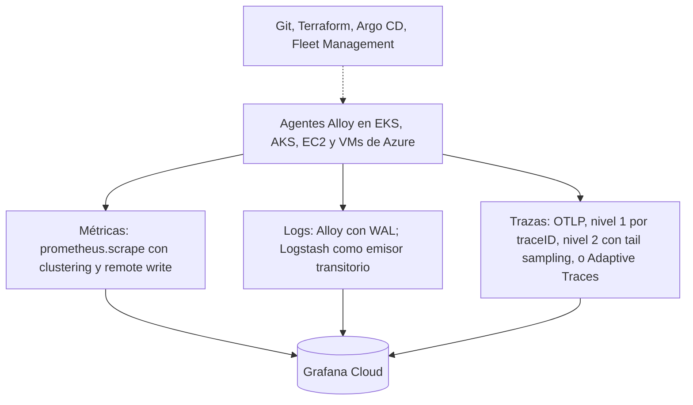

Alloy con su motor por defecto como agente en todos los entornos, administrado con Fleet Management, GitOps y Terraform; un gateway de trazas con dos niveles o Adaptive Traces; Contrib solo como gateway acotado ante un componente ausente; Logstash conservado de forma transitoria donde la migración no se justifique.

### Respuesta a los diez puntos solicitados

| # | Punto | Respuesta |
| --- | --- | --- |
| 1 | Por qué ofrece el mejor equilibrio | Mayor puntuación ponderada (4,21 frente a 3,49 y 3,72); menor complejidad (1,6); soporta Prometheus, Kubernetes y Fleet Management con menos piezas |
| 2 | Funcionalidades de Grafana Cloud que habilita | Kubernetes Monitoring con alertas, Application Observability, perfiles, Database Observability, Adaptive Telemetry, Cloud Provider Observability y Fleet Management |
| 3 | Tareas resueltas de forma nativa | Descubrimiento, reparto de scrape por clustering, exporters embebidos, logs con WAL, balanceo y tail sampling, registro y salud de agentes |
| 4 | Componentes adicionales obligatorios | Helm y Git; Argo CD o Flux; Terraform; gestor de secretos; Logstash si se conserva |
| 5 | Requiere configuración adicional | Taxonomía de atributos, anillos canario, stacks por entorno, políticas de muestreo, límites de series |
| 6 | Limitaciones que permanecen | Sintaxis propia del motor por defecto; sin `groupbytrace`; RBAC de Fleet Management por stack; sin oleadas nativas; OTel Engine en preview |
| 7 | Esfuerzo operativo relativo | Gobierno a 36 meses: 82 a 123 días-persona con Alloy frente a 164 a 246 con Contrib y 246 a 328 con la híbrida |
| 8 | Qué es portable | Instrumentación OTLP, convenciones semánticas, logs estructurados, métricas Prometheus, configuración en Git; en la ruta de salida, el motor OTel de Alloy |
| 9 | Qué validar antes de comprometerse | Contrib con Fleet Management en Kubernetes, Supervisor sin conexión, plan de Fleet Management, rendimiento de logs, fragmentación de trazas, identidades de Azure |
| 10 | Cuándo cambiaría | Portabilidad por encima de un tercio del peso; un componente indispensable ausente de Alloy; fallos de Alloy en el piloto; motor OTel de Alloy en disponibilidad general |

### Decisión por escenario del cliente

| Escenario | Arquitectura recomendada | Por qué | Componentes | Principal riesgo |
| --- | --- | --- | --- | --- |
| Prioridad absoluta a administración centralizada | C4: Alloy con Fleet Management | Un binario y un plano de gestión; aislamiento y retorno automático a la última configuración válida | Alloy, Fleet, Git con CI, Terraform | RBAC por stack y topes; sin oleadas |
| Prioridad absoluta a portabilidad | A: Contrib con Fleet por OpAMP en hosts, o C5 si se acepta preview | YAML upstream sin capa propietaria | Contrib, Supervisor, Operator y Target Allocator | Sin guía oficial en Kubernetes; Kubernetes Monitoring reducido; OpAMP en beta |
| Prioridad a Kubernetes y Fleet Management | C4 con el chart de Kubernetes Monitoring v4.1 o posterior | Onboarding oficial y funcionalidad completa | Chart, Fleet, Argo CD o Flux | Acople entre chart y pipelines de autodiagnóstico; colectores por nodo |
| Necesidad de tail sampling y balanceo avanzado | C4 con tier de gateway Alloy, o Adaptive Traces; C1 solo si falta un procesador | Los componentes existen en Alloy; Adaptive Traces evita operar el gateway | Gateway con `loadbalancing` y `tail_sampling`, o Adaptive Traces | Punto único de fallo, memoria y volumen del 100 % enviado en Adaptive Traces |
| Multi-cloud con operación sencilla | C4 con stacks separados por entorno | Un estándar para AWS, Azure y on-premises | Alloy, Terraform, Helm, conectividad privada | Sintaxis Alloy no portable; operación de la conectividad privada |
| Cliente con Logstash existente | C4: Alloy como colector destino y Logstash como emisor transitorio | Grafana no recomienda el plugin de Loki para despliegues nuevos | Alloy con `loki.source.api` o syslog, `loki.process` | Procesamiento doble y duplicados durante la transición |

### Orden de adopción sugerido

1. Fase de piloto con las pruebas de la sección 18.
2. Agentes Alloy y Fleet Management en un entorno de desarrollo, con la taxonomía de atributos.
3. Métricas de infraestructura y logs; después trazas con Adaptive Traces o el tier de gateway.
4. Producción con anillo canario y stacks separados si hay requisitos de aislamiento.
5. Revisión semestral del estado del motor OTel de Alloy y de los componentes ausentes.
