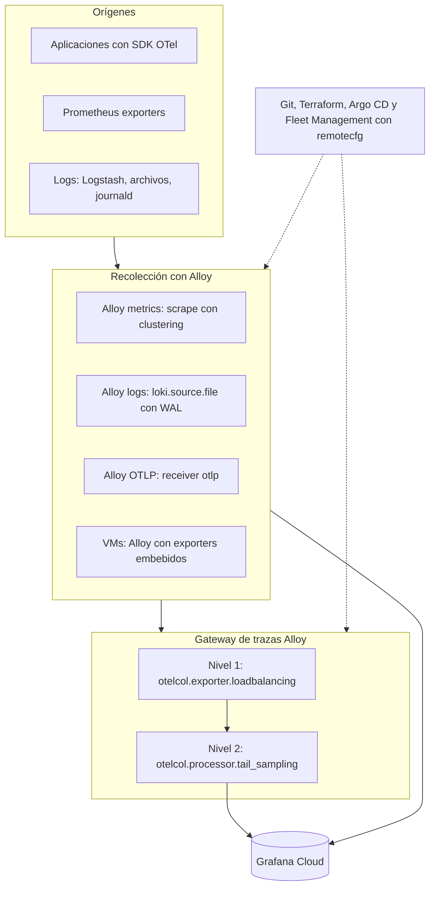

[← Anterior](04-arq-a.md) · [Índice](../README.md) · [Siguiente →](06-arq-logica.md)

# Arquitectura de la opción B: Grafana Alloy

*Sección 4 · página 6 de 36*

Leyenda: ✅ verificado · 🟡 inferido · ⚠️ no confirmado · 🧪 preview o experimental

> En la opción B el descubrimiento, el reparto de scrape, la recolección de logs y el registro en Fleet Management viven en el mismo binario; las piezas externas se reducen a Helm y Git. El gateway de trazas sigue siendo un tier separado.

### Componentes y su estado ✅

| Pieza | Componente de Alloy | Estado |
| --- | --- | --- |
| Descubrimiento | `discovery.kubernetes`, `.ec2`, `.azure`, `.dns`, `.file`, `.http`, `.consul` y otros | Motor por defecto, estable |
| Reparto de scrape | `clustering` en `prometheus.scrape` | Gossip, hashing consistente, activación por componente |
| Logs | `loki.source.file`, `loki.source.kubernetes`, `loki.write` con bloque `wal` | Motor por defecto |
| Trazas | `otelcol.exporter.loadbalancing`, `otelcol.processor.tail_sampling` | `tail_sampling` GA; `loadbalancing` envuelve el exportador upstream |
| Administración | `remotecfg` con Fleet Management; chart v2.0 o posterior | Onboarding oficial en Kubernetes |
| Salida de portabilidad | Motor OTel (`alloy otel`) | 🧪 preview; `otel-supervisor` 🧪 experimental |

### Límites de esta opción

- La sintaxis del motor por defecto es propia de Alloy; la portabilidad se resuelve en la instrumentación y en el uso de OTLP, no en el archivo de configuración.
- Alloy no incluye `groupbytrace` ni el conector `routing` en el motor por defecto ni en el bundle OTel 🟡 (inferido de la lista de componentes).
- El motor OTel no tiene UI, support bundles ni endpoint de recarga ✅.

*Fuentes: [OpenTelemetry en Alloy](https://grafana.com/docs/alloy/latest/introduction/otel_alloy/), [distribución de carga con clustering](https://grafana.com/docs/alloy/latest/configure/clustering/distribute-workload/), [tail_sampling](https://grafana.com/docs/alloy/latest/reference/components/otelcol/otelcol.processor.tail_sampling/), [Kubernetes](https://grafana.com/docs/grafana-cloud/observe-and-act/send-data/fleet-management/set-up/onboard-collectors/kubernetes.md).*

---
[← Anterior](04-arq-a.md) · [Índice](../README.md) · [Siguiente →](06-arq-logica.md)
