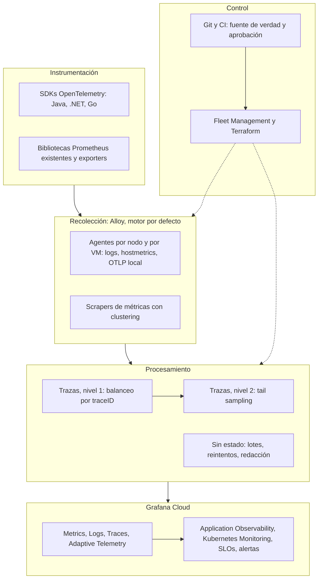

[← Anterior](05-arq-b.md) · [Índice](../README.md) · [Siguiente →](07-discovery.md)

# Arquitectura lógica recomendada

*Sección 4 · página 7 de 36*

Leyenda: ✅ verificado · 🟡 inferido · ⚠️ no confirmado · 🧪 preview o experimental

> La arquitectura recomendada separa recepción, procesamiento, balanceo y exportación por señal, con Alloy como agente único, un gateway de trazas con dos niveles y un plano de control por Git.

### Decisiones de diseño

| Decisión | Razón | Evidencia |
| --- | --- | --- |
| Un solo agente por nodo | Menos distribuciones y un solo plano de gestión | ✅ tabla de complejidad en el anexo |
| Balanceo solo para trazas (y logs por traceID cuando se necesite) | Tail sampling exige que todos los spans de una traza lleguen a la misma instancia; las métricas se escalan por sharding de targets, no por balanceo | ✅ |
| Gateway sin estado separado del de muestreo | El muestreo es de memoria; el resto escala por throughput | 🟡 |
| Span metrics en Grafana Cloud por defecto | Es la fuente por defecto de Application Observability y evita generar series en el collector | ✅ |
| Contrib solo ante componente ausente | Evita una segunda distribución sin capacidad nueva | 🟡 |

### Qué cambia por entorno

Producción, preproducción y desarrollo comparten los mismos perfiles de configuración y se diferencian por el atributo `environment` en Fleet Management; el control de acceso por entorno requiere stacks separados porque el RBAC de Fleet Management es por stack.

---
[← Anterior](05-arq-b.md) · [Índice](../README.md) · [Siguiente →](07-discovery.md)
