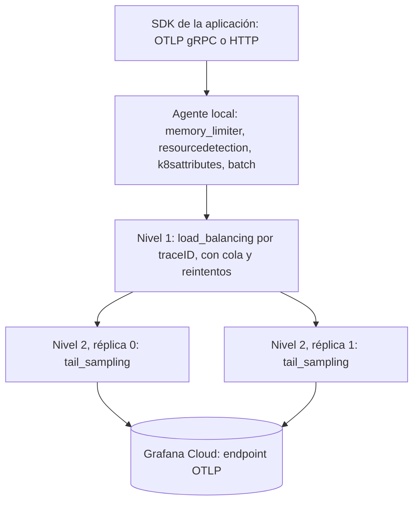

[← Anterior](14-logs-decision.md) · [Índice](../README.md) · [Siguiente →](16-loadbalancing.md)

# Trazas: del SDK a Grafana Cloud con OpenTelemetry de extremo a extremo

*Sección 9 · página 16 de 36*

<sub>Leyenda: ✅ verificado · 🟡 inferido · ⚠️ no confirmado · 🧪 preview o experimental</sub>

> El pipeline de trazas cambia de forma cuando se añade tail sampling: deja de ser «recibir, procesar, exportar» y pasa a ser dos tiers, uno sin estado que reparte por traceID y otro con estado que decide.



### Procesadores y su madurez

| Etapa | Componente | Estado | Nota |
| --- | --- | --- | --- |
| Recepción | `otlp` gRPC y HTTP | Núcleo estable | Agentes locales por nodo para no exponer el gateway a aplicaciones |
| Protección de memoria | `memory_limiter` | Núcleo | Colocar primero; Grafana recomienda `limit_mib` cercano al 80 % del límite del pod ✅ |
| Lotes | `batch` | Núcleo | Después del muestreo, no antes |
| Recurso | `resourcedetection`, `k8sattributes`, `resource`, `attributes` | Bundle de Alloy y Contrib ✅ | Aseguran `service.name`, `deployment.environment` y metadatos de Kubernetes |
| Transformación y filtro | `transform`, `filter` | Bundle de Alloy y Contrib ✅ | OTTL; una función de OTTL puede requerir feature gate |
| Muestreo probabilístico | `probabilistic_sampler` | Alloy y Contrib | Decisión por trace ID; no necesita agrupar spans |
| Tail sampling | `tail_sampling` | beta en Contrib; GA en Alloy | Todos los spans de una traza a la misma instancia |
| Balanceo | `load_balancing` | beta trazas | Ver la página siguiente |
| Exportación | `otlp` y `otlphttp` | Núcleo | TLS y `basicauth` o `oauth2client` |

### Cómo cambia la arquitectura al introducir tail sampling

1. Los agentes envían sin muestrear al nivel 1 (si se muestrea antes, la métrica de spans pierde el flujo completo).
2. El nivel 1 agrupa por traceID con hashing consistente.
3. El nivel 2 retiene spans durante `decision_wait` (30 s por defecto) hasta `num_traces` (50 000 por defecto) y decide con políticas.
4. Las políticas se evalúan en orden; una política `drop` evita conservar trazas triviales como health checks.
5. Los metrics de spans se generan **antes** del muestreo, en otro pipeline con balanceo por servicio ✅.

### Dimensionamiento con variables

```latex
trazas_en_memoria  ≈ λ_trazas × decision_wait
memoria_nivel2     ≈ trazas_en_memoria × tamaño_medio_de_traza × factor_de_overhead
réplicas_nivel2    ≥ memoria_nivel2 ÷ memoria_útil_por_réplica
```

`num_traces` debe ser igual o mayor que `trazas_en_memoria` por réplica; si no, las trazas más antiguas se desalojan antes de decidir (o se bloquea la entrada si `block_on_overflow` está activo, en Alloy). Los valores salen de las variables del cliente, no de números inventados.

### Alloy frente a Contrib en trazas

| Aspecto | Alloy | Contrib |
| --- | --- | --- |
| Tail sampling | `otelcol.processor.tail_sampling` GA; añade `decision_cache`, `block_on_overflow`, `num_shards` | Procesador upstream beta; en v0.163.0 hay además `adaptive_tail_sampling` alpha |
| Balanceo | `otelcol.exporter.loadbalancing`; claves `traceID`, `resource`, `metric`, `streamID` según su documentación | `load_balancing` con claves `service`, `traceID`, `metric`, `resource`, `streamID`, `attributes`, `randomness` |
| Agrupar spans por traza antes del exporter | No existe `groupbytrace` en el motor por defecto ni en el bundle OTel 🟡 | Procesador `groupbytrace` |
| Esfuerzo de implementación | 4 a 6 días-persona, ambos tiers | 4 a 6 días-persona, ambos tiers |
| Riesgo operativo | Punto único de fallo y memoria en el nivel 2 | Igual, más el cambio frecuente de nombres y de estados de componentes |

*Fuentes: [tailsamplingprocessor](https://pkg.go.dev/github.com/open-telemetry/opentelemetry-collector-contrib/processor/tailsamplingprocessor), [tail_sampling en Alloy](https://grafana.com/docs/alloy/latest/reference/components/otelcol/otelcol.processor.tail_sampling/), [loadbalancing en Alloy](https://grafana.com/docs/alloy/latest/reference/components/otelcol/otelcol.exporter.loadbalancing/), [notas de v0.163.0](https://newreleases.io/project/github/open-telemetry/opentelemetry-collector-contrib/release/v0.163.0).*

---
[← Anterior](14-logs-decision.md) · [Índice](../README.md) · [Siguiente →](16-loadbalancing.md)
